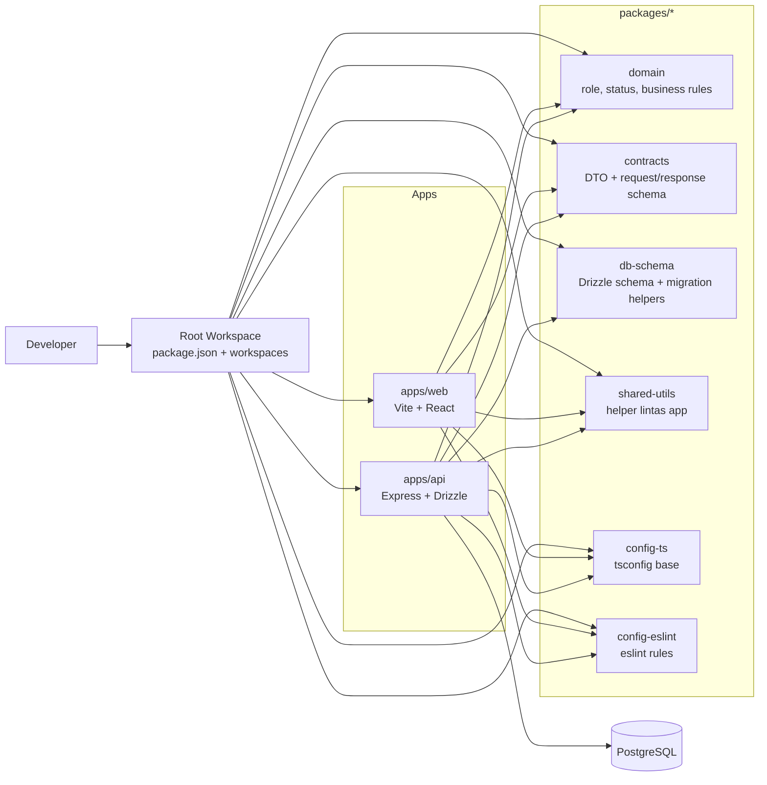
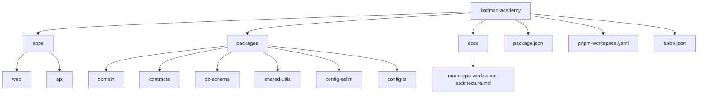

# Arsitektur Monorepo Berbasis Workspace

Dokumen ini menjelaskan apa yang berubah jika menggunakan workspace, apa yang perlu ditambahkan untuk integrasi logic dan business process, serta desain target untuk aplikasi KMP - ADNG Academy.

Written by: GPT-5.3-Codex.

## Tujuan

- Menjadikan frontend dan backend satu sistem terorkestrasi.
- Menyatukan kontrak data (schema/type/DTO) agar tidak drift.
- Meningkatkan kualitas delivery melalui quality gate dan CI/CD terpusat.
- Memudahkan scale ke service baru (worker, notification, reporting) tanpa refactor besar.

## Apa yang Berubah Saat Menggunakan Workspace (Konteks Umum)

## 1. Dependency Management

Sebelum:

- Tiap app mengelola dependency sendiri tanpa governance root.

Sesudah:

- Dependency dikelola dari root workspace.
- Versi package lintas app lebih konsisten.
- Shared package dapat dipakai lewat workspace protocol.

Dampak ke business process:

- Perubahan domain library (misal perhitungan settlement) dapat dirilis serentak ke web/api.

## 2. Source of Truth Kontrak Bisnis

Sebelum:

- Type, enum, dan payload API diduplikasi.

Sesudah:

- Kontrak domain diletakkan di package bersama.
- Frontend dan backend impor dari sumber yang sama.

Dampak ke business process:

- Aturan role, status kursus, dan skema transaksi menjadi konsisten.
- Risiko bug integrasi turun signifikan.

## 3. Orkestrasi Command

Sebelum:

- Menjalankan dev/build/test lintas app dilakukan manual per folder.

Sesudah:

- Root command dapat menjalankan semua app/package secara paralel atau terurut.

Dampak ke business process:

- Siklus delivery fitur lintas tim lebih cepat dan prediktif.

## 4. Quality Gates Terpusat

Sebelum:

- Lint/typecheck/test cenderung parsial dan tidak seragam.

Sesudah:

- Semua package mengikuti standar yang sama.
- PR memiliki guardrail yang konsisten.

Dampak ke business process:

- Regression pada proses penting (auth, enrollment, settlement) lebih cepat terdeteksi.

## 5. CI/CD dan Release Governance

Sebelum:

- Pipeline terpisah atau belum baku.

Sesudah:

- Workflow CI/CD bisa berbasis package impact (affected projects).
- Release lebih aman karena ada gate per paket yang terpengaruh.

Dampak ke business process:

- Risiko downtime akibat perubahan kecil di modul kritis berkurang.

## Kebutuhan Tambahan Jika Pakai Workspace (Konteks Umum)

- Root workspace config (npm/pnpm/yarn workspaces).
- Struktur apps/packages yang eksplisit.
- Base tsconfig bersama.
- Shared eslint/prettier config.
- Shared env policy dan validasi env.
- Dependency graph dan task runner strategy.
- CI pipeline berbasis impacted packages.
- Versioning strategy untuk package internal.

## Arsitektur Target Untuk KMP - ADNG Academy

## Diagram Arsitektur Workspace



## Struktur Folder Target

```txt
kodman-academy/
  apps/
    web/                      # Frontend Vite React (pindahan dari root)
    api/                      # Backend Express Drizzle (pindahan dari backend-academy)
  packages/
    domain/                   # Entity, enum, value object, business rules inti
    contracts/                # API contract: DTO, request/response schema, validators
    db-schema/                # Drizzle schema + migration helpers (tanpa logic HTTP)
    shared-utils/             # Helper lintas app (date/currency/error)
    config-eslint/            # Konfigurasi ESLint bersama
    config-ts/                # Konfigurasi tsconfig base bersama
  docs/
    monorepo-workspace-architecture.md
  package.json                # root scripts orchestration
  pnpm-workspace.yaml         # jika memilih pnpm
  turbo.json                  # opsional, bila pakai turbo
```

## Diagram Struktur Folder



## Logical Layering

- apps/web:
  - Konsumsi API melalui package contracts.
  - Tidak menyimpan ulang enum domain yang sudah ada di packages/domain.

- apps/api:
  - Route/controller memanggil service domain.
  - DTO request/response mengacu ke packages/contracts.

- packages/domain:
  - Sumber tunggal role, status kursus, status transaksi, dan aturan bisnis inti.

- packages/contracts:
  - Definisi payload lintas FE-BE dengan validator schema.

- packages/db-schema:
  - Definisi schema database Drizzle dan lifecycle migration.

## Integrasi Business Process KMP - ADNG (Spesifik App Ini)

## 1. Proses Auth dan RBAC

Perubahan:

- Role enum dipusatkan di packages/domain.
- Middleware auth di apps/api mengimpor role dari packages/domain.
- UI authorization guard di apps/web memakai sumber role yang sama.

Manfaat:

- Tidak ada mismatch role seperti kasus PUBLIC hanya ada di frontend.

## 2. Proses Course Lifecycle

Perubahan:

- Status course (DRAFT, PENDING_REVIEW, PUBLISHED, REJECTED) dipusatkan.
- Contract endpoint create/update/publish dipusatkan di packages/contracts.

Manfaat:

- Creator, admin, dan moderator memakai state machine yang konsisten.

## 3. Proses Enrollment, Review, dan Certificate

Perubahan:

- DTO enroll, progress update, submit exam, dan certificate dipusatkan.
- Web dan API mengikuti validator schema yang sama.

Manfaat:

- Menurunkan bug mapping payload dan response transform.

## 4. Proses Settlement dan Wallet

Perubahan:

- Rule pembagian revenue dibuat dalam domain service bersama.
- API hanya sebagai orchestration entrypoint.

Manfaat:

- Perhitungan finansial tidak tersebar di banyak tempat.
- Audit logic lebih mudah.

## 5. Proses Approval dan Governance

Perubahan:

- Workflow approval (mentor/creator/content) jadi use-case domain eksplisit.
- Event penting dicatat terstruktur untuk kebutuhan audit.

Manfaat:

- Kontrol admin/direktur/superadmin lebih jelas dan traceable.

## Standar Integrasi Antar Package

- Arah dependensi wajib satu arah:
  - apps/_ boleh depend ke packages/_.
  - packages/domain tidak boleh depend ke apps/\*.
- Hindari circular dependency antar package.
- Semua package punya boundaries jelas (public API via index file).
- Setiap perubahan contract wajib disertai bump versi internal dan changelog.

## Strategi Implementasi Bertahap

## Tahap A - Foundation

- Bentuk workspace config di root.
- Pindahkan frontend ke apps/web.
- Pindahkan backend ke apps/api.
- Tambah root scripts untuk dev/build/lint/typecheck/test.

Keluaran:

- Menjalankan seluruh sistem dari root dalam satu command.

## Tahap B - Shared Domain dan Contract

- Buat packages/domain untuk role, status, dan rule inti.
- Buat packages/contracts untuk schema request/response.
- Refactor web dan api agar impor dari package shared.

Keluaran:

- Single source of truth untuk domain dan API contract.

## Tahap C - Quality dan CI/CD

- Pasang lint/typecheck/test gate lintas workspace.
- Tambah CI workflow untuk affected packages.
- Tambah coverage threshold bertahap.

Keluaran:

- PR governance stabil dan terukur.

## Tahap D - Reliability dan Security

- Env validation terpusat.
- Rate limiting, CORS allowlist, upload policy.
- Structured logging + correlation id + monitoring.

Keluaran:

- Kesiapan production untuk operasional harian.

## Daftar Keputusan Arsitektur yang Perlu Disepakati

- Pilihan package manager workspace: npm atau pnpm.
- Pilihan task orchestrator: native workspace script atau turbo.
- Strategi validasi contract: zod-first atau type-first.
- Strategi versioning package internal: fixed atau independent.
- Strategi migrasi database antar environment.

## Definition of Done Monorepo Workspace

- Semua app dapat dijalankan dari root command.
- Role/domain contract hanya berada di package shared.
- Lint, typecheck, dan test menjadi syarat merge.
- CI mengeksekusi hanya package terdampak dengan benar.
- Dokumen operasional deploy dan rollback tersedia.
